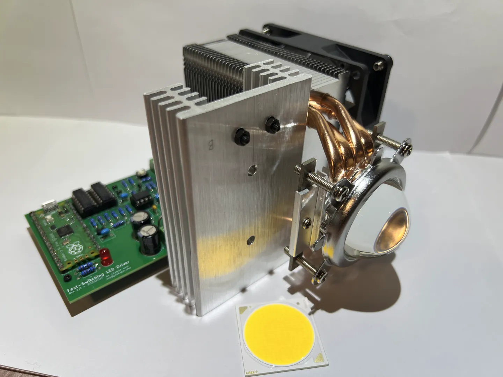

# Photoacoustic Music Box

A WIP project, the goal is to use light to make music via the photoacoustic effect.

## About The Project

Most studies and research on photoacoustics have used lasers, and some have even used sunlight.

For my use case, lasers are not a good fit since they are either too weak to produce any noticeable sound or too strong and will melt the material. I also don't have those thousand-dollar lasers designed specifically for the lab.

Using the sun is an interesting idea, but there are a few issues. First, I want more than just to generate audio; I want to make music! This means the frequency needed is much higher than what a spin wheel can achieve. Not to mention, you will need to be able to accelerate and decelerate the wheel very quickly, which is just not possible. Second, ~~I hate the sun~~, using the sun means that I need to do a lot of the testing outside, which is just not that convenient.

So I decided to try using a high-wattage LED, and I can even reuse my old projector LED. Although later I decided to buy a new LED.

I actually just found out that there are people who managed to use an ordinary LED and BUTTERFLY WINGS (!!!) to generate over 70dB music. They even published a paper! Just today (2026-10-26)! ([When Butterfly Meets Photoacoustic Effect](https://dl.acm.org/doi/10.1145/3795866.3844464))

It's actually good news for me. Now I know for sure this is actually feasible. Of course, I am not going to use butterfly wings, but probably just soot on mesh, which is what most other people use. So there is still a chance that it won't work as well.

Anyway, to drive the LED, I designed a custom PCB to generate the high-speed pulsing needed. 

My original design was pretty simple and straightforward: A Pi Pico generates the pulse signal, and a gate driver switches a power MOSFET that drives the CXB3590 LED from a 48V input. The LED current is set by 4 paralleled 0.39 Ω sense resistors, and an on-board 12V rail feeds a 5V regulator for the logic.

But since I am pretty new to designing circuits, especially high-power one, I was like, "let's see what the AI has to say about it." Claude absolutely roasted my design and told me 3 million different ways that it could kill me. Ok, whatever, I listened to its advice, modified the design a bit, and added a buttload of safety features. Which, to be fair, is a good idea anyway.